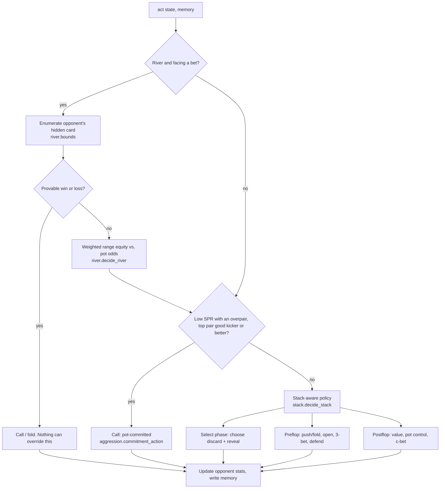

# poker_bot_nolimit

A tournament bot for a no-limit Hold'em variant where every player is dealt **three** hole cards, then after the flop must secretly discard one and publicly **reveal** one of the two they keep. I built it for the No Limits poker bot competition (hosted by Citadel, OpenAI and Sequoia).

The bot is plain Python with no third-party dependencies beyond the competition SDK (`poker_agent_sdk`, supplied by the organizers and not included here). It is rule-based, not a solver: a ranked starting-hand table, a position- and stack-aware betting policy, a small Bayesian opponent model, and an exact river calculator that exploits the revealed card.

## The variant

| Stage | What happens |
|---|---|
| Deal | Each player gets 3 hole cards. Blinds and (at later levels) antes are posted. |
| Preflop | Normal no-limit betting, but on 3-card hands. |
| Flop | 3 community cards. |
| Select | Every remaining player, simultaneously and without seeing anyone else's choice, discards 1 card (dead for the rest of the hand) and picks 1 of the 2 kept cards to show face up. |
| Flop betting, turn, river | Standard no-limit betting. From here on everyone plays a normal 2-card Hold'em hand, except each opponent's hand is half-public. |
| Showdown | Best five of 2 hole cards + 5 board cards. |

Tournament and platform rules that shaped the design:

- **Multi-table freezeout.** Up to 10 seats per table, rising blind levels with antes, and a payout table, so chip EV is not the same as prize EV near the money.
- **Stateless agent.** `act(state, memory)` is called for every decision. Nothing may persist between calls except an opaque per-table `memory` byte string (capped by `state.config.memory_bytes`, at most 16 KB). All opponent modelling has to be serialized into it.
- **Legal-action envelope.** The engine supplies legal actions with min/max raise amounts; any illegal or crashing response costs the hand. Every exit path of the agent is therefore guarded and falls back to check/fold.

## What the variant changes strategically

1. **Preflop hands are stronger and closer together.** Three cards give three possible two-card holdings, so a "percentile" computed from two-card Hold'em overstates how good a hand is. The bot re-ranks all 22,100 three-card deals at import time.
2. **The discard is a hand-construction problem.** You choose which two cards to keep after seeing the flop, and so does everyone else. That favours made hands and nut draws, and punishes weak pairs and non-nut draws in multiway pots.
3. **The reveal leaks information both ways.** On the river, an opponent with one exposed card has only ~44 possible hands. That is small enough to enumerate exactly, and sometimes enough to *prove* a call wins or a call loses.

## How a decision is made



Every step runs inside its own `try`. If anything throws, the agent falls back to the cheapest legal passive action. A river proof is reapplied at the very end, so a failure in a later stage cannot replace it.

### 1. Starting hands: `cards.py`

- Each two-card holding gets a linear score: pair base plus rank, high and low card rank, suited bonus, gap penalty, broadway bonus.
- A three-card hand scores `best_pair + 0.08 × second_best_pair`, so a backup holding is worth a little.
- All 22,100 three-card combinations are sorted once at import into a percentile table (`THREE_PCT`). At runtime "is this hand in my top 18%?" is one dictionary lookup.
- `strength()` is an exact best-five evaluator for 5 to 7 cards. It uses rank counts and per-suit bitmasks (straights are a sliding 5-bit window) instead of looping over the 21 five-card subsets.
- `tier()` sorts a postflop hand into 0 (air), 1 (weak), 2 (top pair / overpair) or 3 (strong). A hand that only plays the board (e.g. trips on the board plus a kicker) is downgraded.

### 2. Discard and reveal: `selection.py`

For each of the three possible discards the bot computes a keep score:

- made-hand category weight (pair to straight flush), pair rank and kickers;
- flush and straight **outs**, counted against every card it has seen, including its own discard;
- nut-flush draws weighted up; non-nut draws discounted as more opponents stay in, because they are also choosing their best two from three;
- weak pairs (below the top board card) penalized by the number of opponents and by preflop raise pressure.

It then picks which kept card to show. By default it reveals the card that tells opponents least, i.e. the one with the fewest rank and suit matches on the board. 20% of the time it reveals the more informative card, so the reveal alone does not give its hand away. That 20% is decided by a hash of the hand number and seat (Knuth multiplicative constants) rather than a random number generator, so a replay produces the same decisions.

### 3. Preflop policy: `stack.py`, `strategy.py`, `aggression.py`

- **Short stacks (≤ 10 bb, 12 bb heads-up, 8 bb with big antes):** push/fold. Ranges depend on how many players are left to act behind and get wider at 4-, 3- and 2-handed.
- **Deeper stacks:** open-raise with position-dependent ranges (12% early up to 35% small blind; 68% heads-up from the button). Open size is 2.0, 2.2 or 2.5 bb depending on depth, plus one bb per limper. Deep stacks can open speculative three-card structures in position: a pair plus a spare card, a suited ace, or connected cards.
- **Facing a raise:** a narrow 3-bet range (3.2× out of position, 2.7× in position), widened against seats that open wide or fold too much. Defending a min-raise from the big blind is wider. 4-bet pots shrink to roughly the top 1.5–3.5%.
- **Premium floor:** if any two of the three cards make AA, KK, QQ or AK, the bot never folds preflop. It value-raises when the raise costs ≤ 40% of the effective stack, and calls otherwise.
- **Bubble and payouts:** `risk_factor()` is a cheap ICM proxy. Its size depends on how flat the payout table is, whether we are one place from the money, and whether a short stack is still at the table. It narrows every range and raises every calling price. It only applies when the opponent covers us.

### 4. Postflop policy: `stack.py`

- Strong hands bet 70–90% pot. The bet is larger against calling stations, and against seats that have been seen calling expensive bets with weak hands.
- Strong hands are held back on a four-flush or four-straight board that they do not beat.
- One-pair hands get pot control: capped bet sizes when deep, and folds to raises after we have bet. That rule is loosened only against seats with measured bluffing evidence.
- Bluffs are limited to heads-up continuation bets by the preflop raiser on the flop and turn. They are never fired on the river, against calling stations, or after the turn bet was called.
- If an opponent's exposed cards already beat our hand on the visible board, the hand is never played aggressively.

### 5. River math: `river.py`

When heads-up on the river, facing a bet, against an opponent showing one card:

1. Build the set of dead cards: our hand, the board, every revealed card, and our own discard.
2. Enumerate every live card the opponent could hold next to the exposed one (≤ 44). Cards with the same rank and the same flush relevance score the same, so they are evaluated once and cached.
3. Count how many we beat, tie and lose to. If we beat all of them, call. If we lose to all of them, fold. If the worst case is a tie and pot odds are at least 2:1, call. These rules hold whatever the range weights are, so nothing later can override them.
4. If none of those apply, weight the outcomes: hands that only play the board count as bluffs (weight 0.12, rising with observed bluffs), weak pairs 0.25, top pair 0.60, two pair or better 1.0. Call if weighted equity is at least `call / eligible_pot + risk premium`.

`eligible_pot()` rebuilds each seat's contribution from the action history, so the price uses only the part of the pot we can actually win (side-pot safe). If the history does not add up to the reported pot, the bot skips the equity-based call and acts only on the proofs.

### 6. Opponent model: `opp.py`, `tag_opp.py`

The model only uses information from the public event stream. It never tries to infer hidden cards.

- **Per-seat decayed counters:** VPIP, PFR, fold-to-raise, 3-bet, all-in, aggression. Each counter is multiplied by 0.985 every hand, so old hands fade out.
- **Beta-style priors:** each rate starts from a prior worth 10 pseudo-hands (VPIP 25%, PFR 15%, fold 45%). The first few hands therefore cannot push the model to an extreme.
- **Labels:** *station* (VPIP ≥ 40% and fold ≤ 40%), *folder* (fold ≥ 70%, or a seat that never voluntarily puts chips in), *exploitable 3-bet target*.
- **Evidence signals (V3):**
  - opening wider than expected for the seat's position;
  - 3-betting too often;
  - showing down a river bluff;
  - calling expensive bets and then showing a weak hand.

  Each signal uses a confidence lower bound. It stays at 0 until the lower bound clears a threshold, then ramps up as more observations arrive.
- **Serialization:** everything is packed with `struct` into a versioned binary blob (`BA03` magic, table id, one fixed-width row per seat, 196 bytes per seat). A `V5G1` header holds telemetry for the last decision: equity, required equity, risk premium, and which rule fired. If the blob does not decode or belongs to a different table id, the bot starts over with the priors.

## Development history

The parameters in `params.py` are layered by version. Each layer can be turned off separately, which made it possible to compare versions with one change removed at a time:

| Version | Added |
|---|---|
| V2 | Three-card ranking table, exact evaluator, position-aware push/fold. Kept frozen as the baseline. |
| V3 | Public-evidence opponent signals (wide opens, over-calls, river bluffs). |
| V4 | Stack-depth-aware opening, sizing and pot control; better discard scoring; corrected short-handed ranges. |
| V5 | Exact river bounds and proofs, side-pot-aware pricing, decision telemetry in memory. |

## Layout

```
bot/
  agent.py        entry point: Agent.act(state, memory) -> (action, memory)
  params.py       every tunable number, grouped by version
  cards.py        evaluator, three-card preflop table, postflop tiers
  selection.py    discard / reveal choice
  stack.py        preflop + postflop policy, position, ICM-style risk factor
  strategy.py     V2 baseline policy and legal-action helpers
  aggression.py   premium-hand floor, stack-to-pot commitment
  river.py        exact river enumeration and range-weighted equity
  opp.py          decayed Bayesian seat statistics (BA02 format)
  tag_opp.py      V3 evidence signals (BA03 format)
  diagnostics.py  telemetry header packed into memory
```

The modules import each other as `bot.*`. Put the repository root on `PYTHONPATH`, install the organizers' `poker_agent_sdk`, and the engine loads `bot.agent.Agent`.
