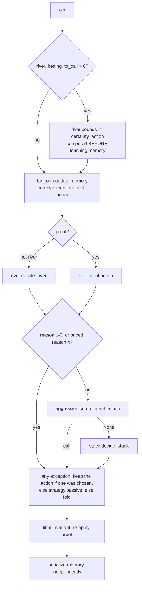

# poker_bot_nolimit

My tournament bot for the No Limits poker bot competition (hosted by Citadel, OpenAI and Sequoia). The game is **`flop_discard_reveal`** ("Bay Area"), a no-limit hold'em variant: everyone gets three hole cards, and after the flop each player discards one and shows one.

The strategy is **heuristic and rule-based. It is not a solver and does not play GTO.** It is made of:

- a precomputed three-card preflop ranking;
- position-, stack- and payout-aware betting rules;
- seat statistics kept in table memory;
- an exact river calculator. It uses an opponent's exposed card to prove some calls win or lose.

This README is in four parts: **game rules** (from the organizers' starter kit), **what the code does** (the current V5 code), **history** (how the code got here), and **open questions** (things not verified).

---

## 1. Game rules

From the starter kit:

| Stage | Rule |
|---|---|
| Deal | 2–10 players. Each gets **three** private cards. |
| Preflop | Standard no-limit betting on three-card hands. |
| Flop | Three board cards. |
| Select | Before flop betting, every remaining player (including all-in players) picks at the same time: one card to **discard** face down and one kept card to **expose**. All choices are locked before any exposure is shown. |
| Flop / turn / river betting | Each player now has two cards, one face up and one face down. |
| Showdown | Automatic: best five from the two kept cards plus the board. Discards never play. Opponents' discards are never shown. |

**Tournament defaults:** 8 players, 2,000 chips each, blinds go up every 20 hands, hand cap of 250. Payouts are 50/30/20 points by default but can be changed (`state.config.payouts`). Places still open at the hand cap are paid by ICM. **The bot is scored on payout points, not chips.**

**Runtime contract:**
- Python 3.12. `class Agent(poker_agent_sdk.Agent)` lives in `agent.py`. `act(state, memory) -> (Action, bytes)`.
- Each decision has 1 ms, including memory handling. Each table also has a 100 ms time bank.
- Agent instances can be swapped between calls, so anything learned about a table has to be stored in the returned `memory` bytes. The platform limit is 64 KB by default; the kit recommends staying under 16 KB. Memory can arrive empty, malformed or truncated.
- At runtime there is no network access, no subprocesses, no background work and no file persistence. `poker_engine` and `pokerkit` are for local testing only and cannot be imported by a submission. Lookup tables that are built once at import and never change are allowed. They do not count as learned state.
- `Action.raise_to(amount)` gives the **total** bet for the round, not the amount added.
- Select returns `Action("select", cards=(discard_index, reveal_index))`. The two indexes must differ and be in 0–2. `state.cards` holds three cards before selection and the two kept cards after it.
- `seats[i].shown_cards` lists public cards. `state.variant["discarded"]` holds **only our own** discard. `state.history` covers the current hand. `state.events` covers everything since our last turn.
- Failure defaults: a failed bet becomes a check or fold. A failed selection discards index 2 and exposes index 0.

---

## 2. What the code does (V5)

### Module map

```
agent.py          Agent.act: action precedence, error containment, memory write
bot/
  params.py       every constant and feature switch (see "Parameters" below)
  cards.py        evaluator, three-card preflop ranking, postflop tiers, simple selection
  selection.py    V4 discard/expose scoring (used, because fix_selection = True)
  strategy.py     legal-action helpers and the V2 baseline policy
  stack.py        main policy: position, ICM-style risk factor, preflop, postflop, select
  aggression.py   premium-hand floor and stack-to-pot commitment rule
  river.py        heads-up river enumeration, proofs, weighted equity, eligible pot
  opp.py          decayed seat counters and their parser (BA02 layout)
  tag_opp.py      V3 evidence counters on top of opp.py (BA03 layout, the one written)
  diagnostics.py  telemetry header for the last decision (V5G1)
```

### Action precedence in `agent.py`



1. **River proof first.** When it is the river and we face a bet, `bounds()` and `certainty_action()` run before memory is parsed. A proof depends only on the cards, so a corrupt memory blob cannot block it.
2. **Opponent update.** `tag_opp.update()` parses the memory and applies `state.events`. If anything fails, it starts over from the priors (`fresh()`).
3. **River decision.** If there is a proof it wins. Otherwise `decide_river()` gives either a tie-bound call (reason 3) or a priced equity decision (reason 4).
4. **Commitment override.** `commitment_action()` may turn a fold into a call when we are pot-committed. It is skipped when reason is 1–3 (proof or tie bound). Because `river_price_authoritative = True`, it is also skipped for a priced reason 4 decision.
5. **Strategy.** If no action has been chosen yet, `decide_stack()` runs with seat labels from `stack.opponent_modes()`.
6. **Containment.** If an exception is raised after an action exists, that action is kept. Otherwise the agent falls back to `passive()` (check, fold, a default select, or call, in that order), and finally to `Action.fold()`.
7. **Final invariant.** If a proof exists it replaces whatever action was chosen. The code comment says no risk, board-danger, evidence or fallback logic may override it.
8. **Memory write.** This happens after the action is fixed, in its own `try`. If it fails, the agent writes a header-only blob, or `b''`, but the chosen action stands.

**Why bookkeeping must never replace a proven river action:** memory is the least trustworthy input. It can be empty, truncated, from an older format, or out of step with the hand. A proven win or loss comes from cards that are certain. If a memory failure could turn a guaranteed call into a fallback fold, a parsing bug would cost real chips. So the proof is computed first, its precedence is recorded, and it is reapplied after every other step.

### Preflop ranking (`cards.py`): a ranking, not equity

- `pair_score()` gives every two-card holding a score: for pairs, base plus rank; otherwise high and low rank, a suited bonus, a gap penalty and a broadway bonus.
- A three-card hand scores `best_pair + backup_weight (0.08) × second_best_pair`.
- All **22,100** three-card deals are sorted once at import. `THREE_PCT` maps each deal to a percentile among all three-card hands. Ranges are written as "top x%" of that list, e.g. `rank < 0.18`.
- **These percentiles are an order, not equity.** They do not estimate how often a hand wins against any range. They count ordered combinations, and the hand-written score decides the order. Two hands one percentile apart can have quite different real equity. The code does not compute preflop equity probabilities.
- `strength()` is an exact best-five evaluator for 5–7 cards. It uses rank counts and per-suit bitmasks; a straight is a 5-bit sliding window.
- `tier()` buckets postflop hands: 3 strong, 2 top pair or overpair, 1 weak or draw, 0 air. A hand that does not beat the board on its own gets tier 0. Board trips that only improve the kicker get tier 1.

### Hardcoded premium behaviour (`aggression.premium_action`)

This runs before every other preflop rule. A hand qualifies if **any two of its three cards** make AA, KK, QQ or AK (suited or offsuit). Percentile does not matter.

| Situation | AA / KK | QQ / AK |
|---|---|---|
| Unopened | Raise to `stack_open_deep` (2.5) × bb | same |
| Facing one raise | 3-bet to 3 × raise | 3-bet to 3 × raise, but only if that costs ≤ 40% of the effective stack (`premium_value_raise_max_fraction`). Otherwise call. |
| Facing 2+ raises or a jam | Raise to the maximum (all-in). Heads-up against a jam: call. | Call |

These hands never fold preflop.

### Stack and position adjustments (`stack.py`)

- **Position.** Seats are counted only among players who have not busted, so the blinds and "players behind" stay correct after eliminations. Heads-up, the button posts the small blind.
- **Push/fold zone.** The effective stack is at or below `push_bb` (10 bb). The limit is 12 bb heads-up, and 8 bb at 7+ players when the ante is at least 15% of the big blind.
  - 4-handed: shove the top 35% of hands, except the big blind checks when the pot is unraised.
  - 3-handed and heads-up: separate shove and call-the-shove ranges.
  - 5+ players: falls through to the V2 `strategy.decide()` push table, which depends on players behind.
- **Deeper stacks.**
  - **Open-raise ranges by position:** early 12%, middle 18%, late 28%, small blind 35%. Short-handed overrides replace these: heads-up 68%, 3-handed 50%, 4-handed 35%.
  - **Open size:** 2.5 bb from 50 bb, 2.2 bb from 25 bb, else 2.0 bb, plus 1 bb per limper.
  - **Speculative hands at ≥ 50 bb:** `speculative()` is a pair plus a spare card, a suited ace, or three cards within a 5-rank span. These get +8% to the opening range in position, and can flat cheap raises from seats flagged as wide.
- **Facing raises.**
  - **3-bet range:** 10% (`aggressive_threebet_pct`), widened against seats with the *wide-opener* signal.
  - **Narrower ranges after more raises:** 3.5% facing a 3-bet, 1.5% beyond that.
  - **Large 3-bets:** a 3-bet that would put in ≥ 40% of the effective stack is made only with the top 2% of hands. Otherwise the hand calls, but only within capped pot odds and stack fraction.
- **Payout risk.**
  - `risk_factor()` is a cheap stand-in for ICM, capped at 0.6. It is larger with flatter payouts, on the bubble, and when a short stack is still alive. It applies only against an opponent who covers us.
  - It shrinks ranges and raises calling prices across preflop, postflop and the river. Exact ICM is not computed.
- **Postflop.**
  - **Tier 3 (strong):** value-bet 70–90% of the pot; more against stations, overcallers and when deep. On a four-flush or four-straight board that the hand does not beat, slow down when facing a bet. On the flop, two pair is not committed when SPR > 1.5.
  - **Tier 2 (one pair, overpair):** pot control, with capped bet sizes when deep. Fold to a raise after we bet, unless the raiser has the *bluff* signal.
  - **Tier 1 (weak, draw):** call only at a good price and for a small fraction of the stack.
  - **Tier 0 (air):** only a heads-up continuation bet by the preflop raiser on the flop or turn, at 65% frequency. Never on the river, never against a station, never after our turn bet was called.
  - **River calls:** without a proof or a priced decision, the river calls only with tier 3, or with a tier-2 one-pair hand at ≤ 20% odds (`fix_river_calls`).
  - **Opponent shows a winner:** if an opponent's exposed cards already beat us on the visible board, the hand is never played aggressively.

### Selection and exposure (`selection.py`)

1. **Score each discard.** `keep_score()` scores each of the three possible discards using:
   - category weight (`select_category`), pair rank and kickers;
   - flush and straight **outs**, counted after removing all three of our original cards and the board;
   - nut-flush draws weighted ×1.15; other draws discounted as more opponents remain, since they are also choosing their best two of three;
   - weak pairs penalized per extra opponent and per preflop raise.

   The best keep wins.
2. **Break near-ties.** If several keeps make the same hand within `exposure_keep_tie` (0.05), pick the keep whose shown card can tell opponents least.
3. **Choose what to expose.** By default, expose the kept card that matches the fewest board ranks, then the fewest board suits, then has the lowest rank. With probability `expose_connected_probability` (20%), expose the more informative card instead, so the exposed card is not a reliable tell. This only happens when we have chips and an opponent can still act.
4. **No RNG.** The 20% coin flip is a multiplicative hash of hand number and seat, so the same state always gives the same action.

`cards.select()` (category first, with a draw/pair bonus) is the older V2 rule. It is still used if `fix_selection` is off, or if selection is somehow called without exactly three cards and three board cards.

### Opponent observations in table memory (`opp.py`, `tag_opp.py`, `diagnostics.py`)

Everything comes from public events. No hidden hole cards are inferred, and opponents' discards are never visible.

- **Base counters** (`opp.update_data`). One pass over `state.events`. It tracks per seat, with every counter multiplied by `decay` = 0.985 at each new hand:
  - VPIP and PFR;
  - fold vs. fold opportunities;
  - 3-bet vs. 3-bet opportunities;
  - all-ins, raises and calls.

  It also follows every seat's chips and bets through the hand. Rates use pseudo-count priors (`prior_weight` 10; VPIP 0.25, PFR 0.15, fold 0.45).
- **Seat labels** (`stack.opponent_modes`, after ≥ 6 observed hands):
  - **station:** VPIP ≥ 40% and fold ≤ 40%.
  - **folder:** fold ≥ 70%, or ≥ 8 actions and none voluntary.
  - **exploit seat:** ≥ 8 fold chances and ≥ 80% folds, plus whether its 3-bets look genuine.

  `opp.modes()` (12-hand minimum) is the older version. It is still defined but not called.
- **Evidence signals** (`tag_opp.observe` / `signals`):
  - opens wider than its positional expectation;
  - 3-bets more often than the prior;
  - calls expensive bets (≥ 25% pot odds);
  - shows down a river bluff after raising;
  - shows down a weak hand after calling the river.

  Each signal is a confidence lower bound minus a target, ramped up between a minimum and a full sample size. It stays 0 until the evidence is strong. `wide`, `bluff` and `overcall` affect decisions. `reraise` is computed but not currently read by any policy.
- **Wire format.** A little-endian `struct` blob, written last-to-first as follows:
  - 4-byte `V5G1` diagnostics header (equity, required equity, risk and action premiums, call price, eligible pot, action, reason code);
  - `BA03` header and the table id;
  - one 196-byte row per seat (24 counters, chips, bet).

  For 8 seats that is about 1.7 KB, well under the 16 KB the code allows. Decoding is all-or-nothing. Wrong magic, seat count, length or table id discards the blob and starts from the priors. Unwrapping also accepts the old `V5D1` header.

### Heads-up river enumeration (`river.py`)

Runs only when **exactly one** other player is still in and has 1 or 2 shown cards.

1. **Dead cards:** our two cards, the board, the opponent's shown cards, every other seat's shown cards, cards revealed in this hand's history, and **our own** discard (`state.variant["discarded"]`). Opponents' discards are unknown, so their cards stay in the candidate set.
2. **Candidates:** with one exposed card, every remaining card is a possible hidden card (about 40). Cards with the same rank and the same relation to a four-flush suit score the same, so `strength()` runs once per class. With two exposed cards there is exactly one outcome.
3. **Counts:** wins, ties and losses against each candidate. These are **unweighted**.

**Exact bounds (always correct for the candidate set):**

| Reason | Condition | Action |
|---|---|---|
| 1 `guaranteed_win` | we beat every candidate | call |
| 2 `guaranteed_loss` | we lose to every candidate | fold |
| 3 `nonlosing_tie_bound` | no candidate beats us, and required equity ≤ 0.5 | call |

Reason 3 lives in `decide_river()`, so the final step does not reapply it the way it reapplies 1 and 2. It is still protected from the commitment override.

**Heuristic weighted equity (reason 4):**
- Each candidate gets a weight: does not beat the board, or high card → bluff weight (0.12, plus 0.80 × the seat's `bluff` signal); a pair below the top board card → 0.25; top pair or better pair → 0.60; two pair or better → 1.0.
- Weighted equity is compared against `required = call / eligible_pot` plus a premium. The premium has two parts: `risk × 0.10`, and +0.025 when there has been a river re-raise (reduced by bluff evidence).
- **These weights are hand-picked numbers, not a fitted range model.** Reason 4 is an estimate. Reasons 1–3 are exact.

**Eligible pot and ties:**
- `eligible_pot()` rebuilds each seat's contribution from `state.history`. It caps every other seat at what we will have put in after calling, so we only count chips we can win.
- If the rebuilt total differs from `state.pot` by more than one chip, it returns `None`. Proofs 1–2 still apply, but reason 3–4 calls are skipped and normal strategy takes over.
- A tie counts as half the pot. That is correct heads-up, which is the only case this module handles.

**Multiway limits:**
- With two or more opponents there is no enumeration. The river falls back to the tiers and price rules in `stack.postflop`.
- Side pots are not split per opponent.
- The other non-folded players' hidden cards are not modelled.

### Stack-to-pot commitment (`aggression.commitment_action`)

- **When it applies:** postflop, facing a bet, holding an overpair, top pair with a Q+ kicker, or tier 3. If an opponent's shown cards already beat us on the board, it does nothing.
- **What it does:** calls when any of these holds:
  - SPR before the current bet ≤ 3;
  - we have already put in ≥ 30% of our starting stack;
  - (flop only, heads-up) KK+ overpair with SPR ≤ 6.
- **Why SPR is measured before the bet:** so a huge overbet does not on its own count as pot commitment.

### Parameters: which ones are used

`params.py` adds a block of settings for each version. Behaviour comes from what the code actually reads, not from the names. Switches currently on: `v5_river`, `v5_preflop`, `river_guard_enabled`, `river_price_authoritative`, `diagnostics_enabled`, `premium_floor_enabled`, `commitment_enabled`, `short_open_enabled`, `wider_threebet_enabled`, `flop_guard_enabled`, `fix_short_ranges`, `fix_river_calls`, `fix_selection`.

Defined but **never read** by any module, so they have no effect:

- `version`
- `tag_enabled` (despite the comment, it does not gate the V3 signals; those are always computed and used)
- `premium_king_jam_bb`, `premium_queen_jam_bb`, `premium_queen_call_fraction`, `premium_king_call_fraction`
- `tag_open_tighten`, `tag_call_tighten`, `tag_deep_bb`, `tag_no_tighten_bb`, `tag_ante_relief`, `tag_late_relief`, `tag_defend_extra`, `tag_max_defend_odds`, `tag_max_flat_stack_fraction`, `tag_weak_bluffcatch_extra`, `tag_trap_min_bb`, `tag_trap_min_spr`, `tag_value_bet_extra`, `tag_risk_strength`, `tag_cap_pressure_hands`

`min_hands` is read only by the unused `opp.modes()`. The later `tag_min_observations` / `tag_full_observations` values (6 / 24) override the earlier ones (12 / 40), because each `P.update` block replaces earlier keys.

---

## 3. History

| Layer | Content |
|---|---|
| V2 | Three-card ranking, evaluator, position-aware push/fold (`strategy.decide`). The params comment calls it the submitted baseline. |
| V3 | Public-evidence counters and signals (`tag_opp`). |
| V4 | Stack-aware policy (`stack.py`), new discard scoring, corrected short-handed ranges. |
| V5 | River proofs, priced river decisions, eligible-pot rebuild, telemetry, river precedence in `agent.py`. |

This repository does not contain match logs, a test harness or tournament results. No performance claims are made here.

---

## 4. Validation and packaging

This repository is a **submission bundle**, not the full starter kit. The SDK (`poker_agent_sdk`), the local engine, the example bots and the `poker-agent` CLI come with the organizers' kit and are not included.

With the kit installed, from the repository root:

```bash
poker-agent check agent.py          # contract / legality check
poker-agent pack . bot.zip          # build the submission ZIP
```

`poker-agent play` needs the kit's `examples/` opponents, which are not in this repository.

**Submission ZIP layout:**
- `agent.py` at the root, with `bot/` next to it. Maximum 50 MB.
- Do not include the SDK, a virtual environment, credentials or the local engine.

---

## Unverified assumptions / open questions

- **1 ms budget:** not measured here. The heaviest work is import time (the 22,100-deal table); per decision the work is at most ~40 river evaluations plus one pass over new events.
- **Reveal frequency:** the 20% "informative reveal" rate and the river range weights are hand-set. Their effect has not been measured in this repository.
- **Multiway `shown_cards`:** in multiway pots `shown_cards` from other seats are treated as dead cards. If the engine ever reports shown cards differently, `bounds()` returns `None` and the bot falls back to normal strategy.
